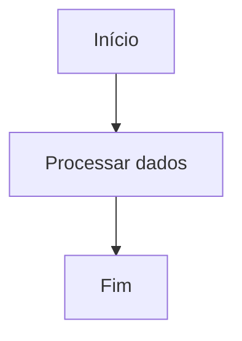
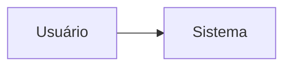
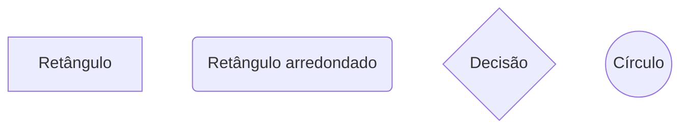
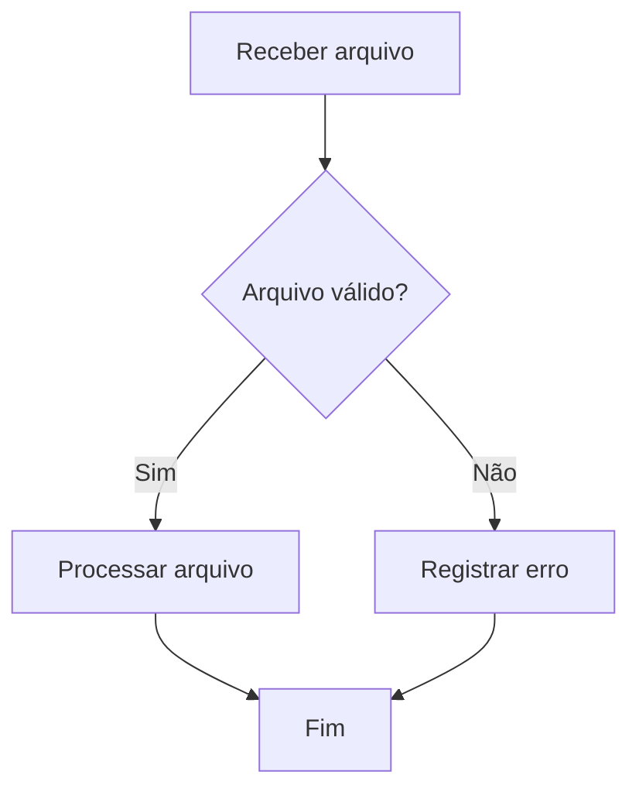
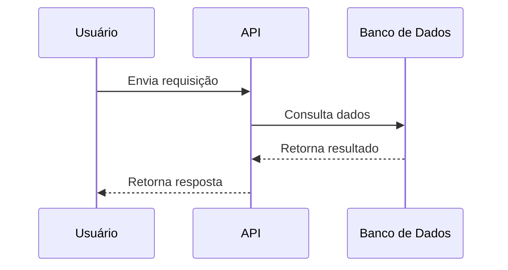
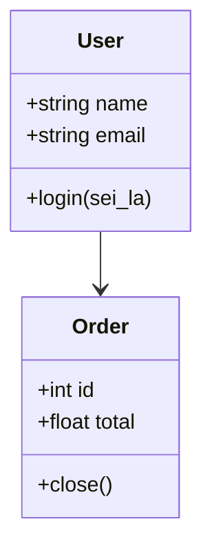

## 1. O que é Mermaid

**Mermaid** é uma ferramenta para criar **diagramas usando texto**, geralmente dentro de arquivos Markdown.

Em vez de desenhar manualmente em ferramentas como Draw.io, Lucidchart ou Visio, você escreve uma pequena estrutura textual, e o Mermaid renderiza isso como um diagrama visual.

Exemplo simples:



Mermaid é muito usado em documentação técnica, README de projetos, wikis, GitHub, GitLab, Obsidian e ferramentas similares. O GitHub, por exemplo, permite criar diagramas Mermaid diretamente em arquivos Markdown, issues, pull requests e wikis. ([GitHub Docs](https://docs.github.com/en/get-started/writing-on-github/working-with-advanced-formatting/creating-diagrams?utm_source=chatgpt.com "Creating Mermaid diagrams"))

---

## 2. Para que Mermaid é usado

Mermaid é usado principalmente para documentar sistemas, fluxos e arquiteturas de forma versionável.

Principais usos:

|Uso|Exemplo|
|---|---|
|Fluxogramas|Etapas de um processo|
|Diagramas de sequência|Comunicação entre sistemas|
|Diagramas de classe|Modelagem orientada a objetos|
|Diagramas de estado|Ciclo de vida de uma entidade|
|ERD|Modelo entidade-relacionamento|
|Gantt|Planejamento de cronograma|
|Git graph|Histórico ou estratégia de branches|
|C4 simplificado|Arquitetura de software|

A documentação oficial descreve Mermaid como uma ferramenta para criar diagramas e gráficos a partir de sintaxe textual. ([Mermaid](https://mermaid.js.org/?utm_source=chatgpt.com "Mermaid | Diagramming and charting tool"))

---

## 3. Por que usar Mermaid

A principal vantagem é que o diagrama vira **código/texto**.

Isso permite:

- versionar diagramas no Git;
    
- revisar diagramas em pull requests;
    
- evitar arquivos binários difíceis de comparar;
    
- manter documentação próxima do código;
    
- gerar diagramas rapidamente;
    
- copiar e colar diagramas entre documentações.
    

Exemplo prático: em vez de salvar um `.drawio`, `.png` ou `.vsdx`, você mantém o diagrama dentro de um `README.md`.

---

## 4. Sintaxe básica

A sintaxe do Mermaid começa declarando o **tipo do diagrama**.

Exemplo com fluxograma:


### Explicação

```text
flowchart TD
```

Define um fluxograma.

O `TD` significa **Top Down**, ou seja, o fluxo vai de cima para baixo.

Outras direções comuns:

| Direção | Significado                          |
| ------- | ------------------------------------ |
| `TD`    | Top Down, de cima para baixo         |
| `BT`    | Bottom Top, de baixo para cima       |
| `LR`    | Left Right, da esquerda para direita |
| `RL`    | Right Left, da direita para esquerda |

---

## 5. Nós e conexões

Em Mermaid, os blocos do diagrama são chamados de **nodes**, ou nós.

Exemplo:



Aqui:

| Parte        | Significado                 |
| ------------ | --------------------------- |
| `A`          | Identificador interno do nó |
| `[Usuário]`  | Texto exibido no diagrama   |
| `-->`        | Seta/conexão                |
| `B[Sistema]` | Segundo nó                  |

A documentação oficial de flowcharts explica que fluxogramas Mermaid são compostos por nós e arestas, ou seja, blocos e conexões. ([Mermaid](https://mermaid.ai/open-source/syntax/flowchart.html?utm_source=chatgpt.com "Flowcharts Syntax | Mermaid"))

---

## 6. Formatos comuns de nós



Tabela resumida:

| Sintaxe      | Forma               |
| ------------ | ------------------- |
| `A[Texto]`   | Retângulo           |
| `A(Texto)`   | Bordas arredondadas |
| `A{Texto}`   | Losango / decisão   |
| `A((Texto))` | Círculo             |

---

## 7. Exemplo com decisão



Esse tipo de estrutura é útil para representar validações, pipelines, regras de negócio e fluxos condicionais.

---

## 8. Diagrama de sequência

Diagramas de sequência mostram a comunicação entre componentes.



Esse tipo de diagrama é muito usado para mostrar chamadas entre frontend, backend, banco de dados, APIs externas e serviços.

---

## 9. Diagrama de classe

Mermaid também suporta diagramas próximos de UML.



Uso comum:

- documentação de classes;
    
- modelagem de domínio;
    
- explicação de relacionamentos;
    
- visão geral de arquitetura orientada a objetos.
    

---

## 10. Resumo final

Mermaid é uma ferramenta para criar diagramas usando uma sintaxe textual parecida com Markdown. É muito útil para documentação técnica porque permite manter diagramas versionados junto com o código.

Em termos práticos:

```text
Markdown + Mermaid = documentação visual versionável
```

Principais casos de uso:

- documentar fluxos de sistema;
    
- representar arquitetura;
    
- explicar comunicação entre serviços;
    
- criar diagramas de classe;
    
- documentar pipelines;
    
- manter diagramas dentro do Git.