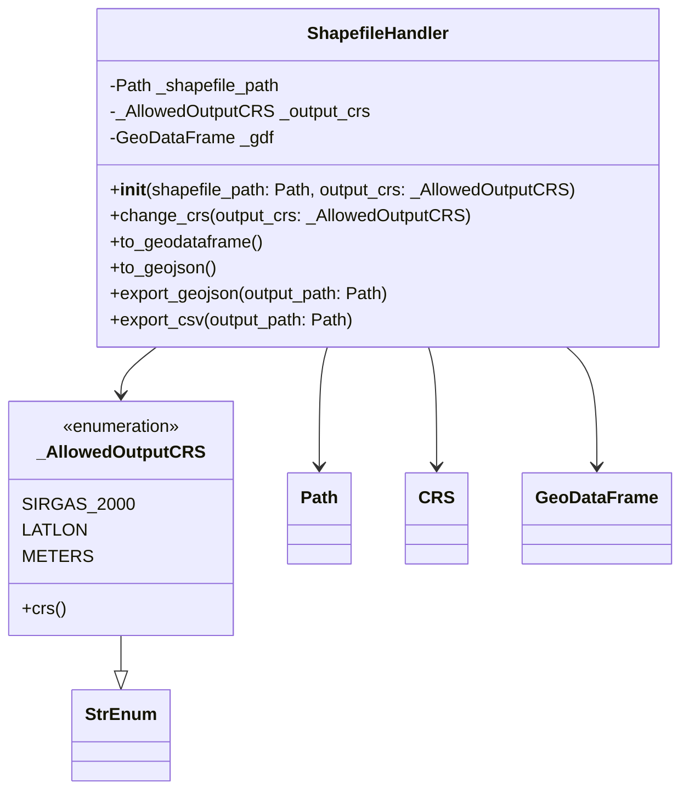
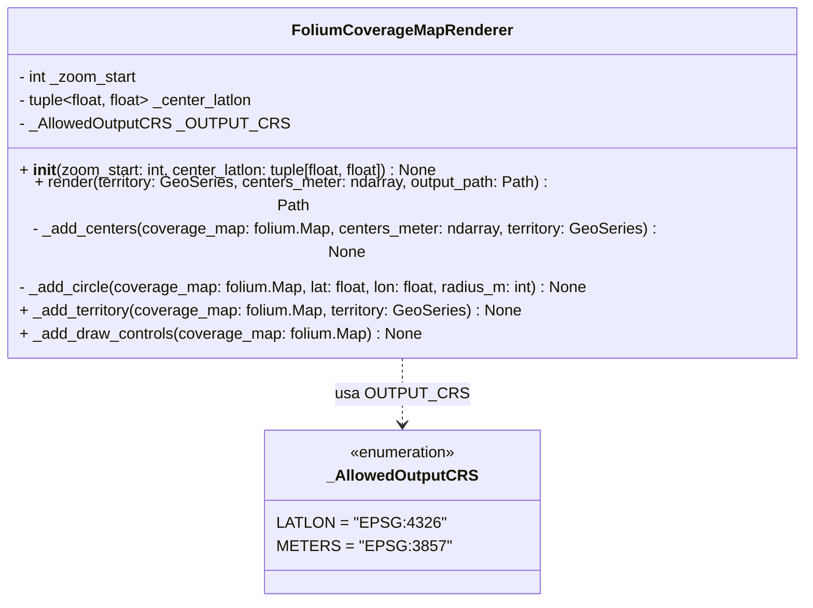

## Introdução  
  
Este projeto tem como objetivo estruturar uma solução automatizada para coleta de dados de clínicas veterinárias em toda a cidade de São Paulo, utilizando a APIs de informações de estabelecimentos como principal fonte de informação.  
  
A abordagem foi desenhada para garantir cobertura territorial completa, padronização dos dados coletados e eficiência no consumo da API.  
  
---  
  
## Escopo da Coleta  
  
A solução contempla a busca de estabelecimentos veterinários em **todo o território da cidade de São Paulo**, sem limitação por regiões específicas.  
  
A coleta não se restringe apenas aos endereços dos estabelecimentos. Serão extraídos dados estruturados disponíveis na API do Google Maps, incluindo:  
  
- Nome do estabelecimento  
- Endereço completo  
- Coordenadas geográficas (latitude e longitude)  
- Horário de funcionamento  
- Tipo de estabelecimento  
- Avaliações e quantidade de reviews  
- Status de funcionamento (aberto/fechado)  
- Identificador único do local (place_id)  
- Demais atributos padrão retornados pela API  
  
Essa abordagem permite construir uma base rica e utilizável para múltiplos fins analíticos e operacionais.  
  
---
## Objetivo

Descrever a abordagem técnica para coleta estruturada de dados de estabelecimentos veterinários na cidade de São Paulo utilizando a API do Google Maps, garantindo cobertura territorial completa e eficiente.

---

## 1. Coleta da Malha Territorial (IBGE)

### Fonte de Dados

A malha territorial será obtida a partir dos dados oficiais do IBGE, no formato **Shapefile (.shp)**, que representa os limites geográficos administrativos.

### Leitura e Processamento

A leitura e manipulação do shapefile será realizada utilizando as seguintes bibliotecas:

- **GeoPandas**: leitura e manipulação de dados geoespaciais
- **PyProj**: transformação de sistemas de coordenadas (CRS)
- **Shapely**: operações geométricas
- **Pathlib**: manipulação de caminhos de arquivos

### Abordagem Técnica

Será utilizada uma abstração orientada a objetos para encapsular o processamento do shapefile, garantindo padronização e reuso.

#### Diagrama UML

### Resultado Esperado

- Conversão do shapefile para **GeoDataFrame**
- Padronização do sistema de coordenadas
- Exportação para **GeoJSON**, formato utilizado nas etapas seguintes

---

## 2. Criação de Mapas

### Biblioteca Utilizada

Será utilizada a biblioteca **Folium**.

### O que é

Folium é uma biblioteca Python para visualização de dados geoespaciais baseada em **Leaflet.js**, permitindo gerar mapas interativos em HTML.

### Justificativa

- Integração direta com GeoJSON
- Facilidade de visualização da cobertura territorial
- Baixo custo computacional
- Geração de artefatos visuais para validação da estratégia

### Abordagem Técnica

O processo de renderização será encapsulado em uma classe responsável por:

- Desenhar o território
- Plotar centros de busca
- Renderizar círculos de cobertura
- Adicionar controles interativos

#### Diagrama UML

### Resultado Esperado

Mapa interativo com:

- Limite territorial de São Paulo
- Centros de coleta
- Áreas cobertas por cada requisição à API

---

## 3. Estratégia de Cobertura Territorial

### Problema

A API do Google Maps impõe limites de raio por requisição. Portanto, é necessário dividir o território em múltiplas áreas de busca garantindo:

- Cobertura completa
- Mínima sobreposição
- Eficiência no número de requisições

### Solução Adotada

Foi utilizada a abordagem de **cobertura do plano por círculos congruentes organizados em malha hexagonal**.

### Por que malha hexagonal

- Minimiza áreas não cobertas
- Reduz sobreposição entre círculos
- Maximiza eficiência espacial em relação a grades quadradas

### Funcionamento

- O território é projetado em um sistema métrico (ex: EPSG:3857)
- Pontos centrais são distribuídos em uma grade hexagonal
- Cada ponto representa uma chamada à API
- Cada chamada cobre um raio
### Benefícios

- Cobertura uniforme de toda a cidade de São Paulo
- Redução de chamadas redundantes à API
- Base estruturada para expansão futura (ex: ajuste por densidade populacional)

![[Pasted image 20260319194805.png]]

---
## 4. Estratégias para Otimização de Custos de Requisição

Com o objetivo de reduzir custos operacionais associados às chamadas à API do Google Maps, serão incorporadas estratégias complementares baseadas em fontes públicas de dados e enriquecimento prévio das informações.

### 4.1 Coleta de Dados via Receita Federal

Será realizada a extração de dados públicos da Receita Federal, filtrando estabelecimentos por:

- **CNPJ ativo**
- **CNAE relacionado a atividades veterinárias**

Essa abordagem permite obter uma base inicial de estabelecimentos formais, reduzindo a dependência exclusiva da API do Google Maps para descoberta de entidades.

---

### 4.2 Padronização e Tratamento de Endereços

Os dados obtidos serão submetidos a um processo de:

- Normalização de logradouros
- Padronização de campos (rua, número, bairro, CEP)
- Remoção de inconsistências e duplicidades

Essa etapa é necessária para garantir maior precisão no processo de geocodificação.

---

### 4.3 Geocodificação via OpenStreetMap

Os endereços tratados serão utilizados para obtenção de coordenadas geográficas (latitude e longitude) por meio da API do **OpenStreetMap (Nominatim)**.

Vantagens:

- Redução de custos (uso de fonte gratuita)
- Independência parcial de APIs pagas
- Criação de uma base georreferenciada inicial

---

### 4.4 Enriquecimento com Coordenadas Geográficas

As coordenadas obtidas serão incorporadas à base de dados, permitindo:

- Identificação espacial dos estabelecimentos já conhecidos
- Redução de consultas redundantes na API do Google Maps
- Uso como base de validação e deduplicação

---

### 4.5 Ajuste de Raios por Densidade Populacional

Será incorporada uma estratégia de ajuste dinâmico dos raios de busca com base na densidade populacional das regiões.

Abordagem:

- Utilização de dados demográficos (ex: IBGE)
- Classificação das regiões por densidade
- Definição de raios maiores em áreas pouco densas
- Definição de raios menores em áreas densas

Benefícios:

- Redução do número total de requisições
- Melhor distribuição espacial das consultas
- Maior eficiência na cobertura territorial

---

### Resultado Esperado

A combinação dessas estratégias permitirá:

- Reduzir significativamente o volume de requisições pagas
- Aumentar a precisão da coleta
- Melhorar a eficiência operacional do processo
- Criar uma base híbrida (dados públicos + API Google)

Essa abordagem transforma a API do Google Maps em um mecanismo complementar de enriquecimento, e não como única fonte de dados.

## Conclusão

A solução proposta combina:

- Dados oficiais (IBGE)
- Processamento geoespacial robusto (GeoPandas, PyProj)
- Visualização interativa (Folium)
- Estratégia geométrica eficiente (malha hexagonal)

Isso garante uma coleta de dados confiável, escalável e com controle preciso sobre a cobertura territorial.
