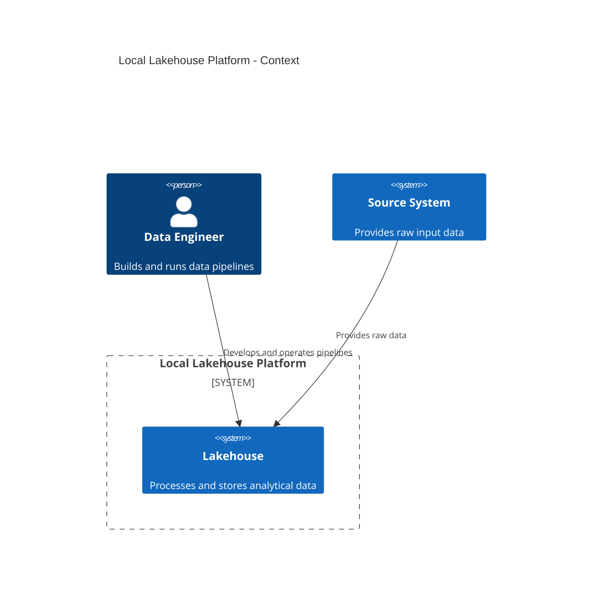

# Data Engineering Skill

## Purpose

Use this skill when the user asks for Data Engineering support that requires technical guidance, implementation planning, Spark/PySpark development, lakehouse design, performance analysis, validation strategy, or architecture organization.

This skill is focused on reusable Data Engineering reasoning. Repository-specific operating rules, coding constraints, default stack assumptions, and project conventions must be kept in `AGENTS.md`.

---

## 1. Technical Depth

Assume an advanced technical level.

Do not over-explain basic concepts unless the user asks.

Explain trade-offs clearly when they affect:

- Data correctness
- Pipeline maintainability
- Performance
- Table design
- Partitioning
- Metastore integration
- Hudi write behavior
- Spark execution
- Orchestration reliability

Avoid generic educational explanations when the user asks for implementation.

---

## 2. Planning and Architecture Diagrams

For organization, planning, and architecture explanation, prefer the C4 Model using Mermaid.

Use C4 diagrams when the user asks for:

- System architecture
- Pipeline organization
- Component boundaries
- Service responsibilities
- Data platform planning
- Repository structure
- Local lakehouse design

Prefer this order when designing a platform:

```text
C4 Context -> C4 Container -> C4 Component
```

Use C4 Context to show external users, source systems, and the lakehouse platform.

Use C4 Container to show major services such as Spark, Hive Metastore, HDFS, PostgreSQL, Airflow, Trino, and MinIO.

Use C4 Component to show internal responsibilities inside a pipeline or application.

Example:



---

## 3. Spark Performance Optimization

Use this topic when the user asks about Spark History Server analysis, job slowness, shuffle reduction, executor resource usage, Spark UI interpretation, or physical optimization of Spark jobs.

These techniques alter physical data movement and hardware utilization to speed up processing.

### 3.1 Data Partitioning and Bucketing

Use partitioning and bucketing to minimize network traffic by pre-arranging data alignment.

Analyze:

- Partition pruning
- Number of partitions
- Output file size
- Join keys
- Shuffle read/write volume
- Skewed partitions
- Task duration distribution

Prefer practical recommendations such as:

- Repartition by high-cardinality processing keys when it improves parallelism.
- Avoid excessive small partitions.
- Avoid partition columns with very high cardinality in storage layout.
- Use bucketing only when repeated joins on stable keys justify the maintenance cost.

### 3.2 Broadcast Joins

Use broadcast joins to eliminate shuffles for asymmetric datasets.

Apply when:

- One side of the join is small enough to fit in executor memory.
- The same small dimension is joined repeatedly.
- The Spark plan shows expensive shuffle joins that can be avoided.

Check:

- Broadcast size
- Executor memory
- Join strategy in the physical plan
- Risk of driver or executor memory pressure

Prefer PySpark examples when showing implementation:

```python
from pyspark.sql import DataFrame
from pyspark.sql import functions as F


def join_with_dimension(fact_df: DataFrame, dimension_df: DataFrame) -> DataFrame:
    """Join a large fact DataFrame with a small dimension DataFrame.

    Args:
        fact_df: Large fact DataFrame.
        dimension_df: Small dimension DataFrame.

    Returns:
        DataFrame enriched with dimension attributes.
    """
    result_df = fact_df.join(
        F.broadcast(dimension_df),
        on="customer_id",
        how="left",
    )

    return result_df
```

### 3.3 File Compaction

Use file compaction to solve the small files problem and reduce storage driver strain.

Analyze:

- Number of files per table or partition
- Average file size
- Scan time
- Metadata overhead
- Hudi compaction or clustering needs
- Output partitions after writes

Prefer compaction when many small files increase planning time, listing overhead, or read amplification.

### 3.4 Garbage Collection and Memory Tuning

Use memory tuning when the Spark History Server, logs, or failed stages indicate memory pressure.

Analyze:

- Executor memory
- Executor overhead
- GC time
- Spill to disk
- Cached DataFrames
- Large shuffles
- Wide transformations
- Skewed tasks
- Out Of Memory errors

Do not recommend increasing memory as the first fix if the root cause is bad partitioning, unnecessary caching, large collect operations, or skew.

---

## 4. Spark Development Best Practices and Coding Standards

Use this topic when writing or reviewing Spark code during the development phase.

These are the fundamental development rules applied directly during coding.

### 4.1 Use High-Level APIs

Use DataFrames and Spark SQL APIs.

Avoid raw RDDs unless the user has a clear low-level requirement.

Prefer high-level APIs because they benefit from Spark optimizers such as Catalyst and Tungsten.

### 4.2 Explicit Data Pruning

Always select specific columns and filter data as early as possible in the script.

Prefer:

```python
from pyspark.sql import DataFrame
from pyspark.sql import functions as F


def select_active_customers(customers_df: DataFrame) -> DataFrame:
    """Select only required columns from active customers.

    Args:
        customers_df: Customer source DataFrame.

    Returns:
        DataFrame with active customers and required columns only.
    """
    filtered_df = customers_df.filter(F.col("is_active") == F.lit(True))

    selected_df = filtered_df.select(
        "customer_id",
        "customer_name",
        "updated_at",
    )

    return selected_df
```

Avoid reading or carrying unnecessary columns through the pipeline.

### 4.3 Smart Caching Policy

Cache only when a DataFrame is reused multiple times.

Always call `unpersist()` after the cached DataFrame is no longer needed.

Prefer:

```python
from pyspark.sql import DataFrame


def process_reused_dataset(source_df: DataFrame) -> tuple[DataFrame, DataFrame]:
    """Process a DataFrame reused by multiple downstream transformations.

    Args:
        source_df: Input DataFrame reused in multiple branches.

    Returns:
        Tuple containing two derived DataFrames.
    """
    cached_df = source_df.cache()

    first_result_df = cached_df.select("customer_id", "updated_at")
    second_result_df = cached_df.select("customer_id", "status")

    cached_df.unpersist()

    return first_result_df, second_result_df
```

Do not cache by default.

Do not cache DataFrames that are used only once.

---

## 5. Validation

For each important pipeline, suggest validation checks such as:

- Row count validation
- Null checks for required columns
- Duplicate checks by natural key
- Schema validation
- Referential integrity checks
- Accepted value checks
- Date range checks
- Reconciliation between source and target

Use Python or PySpark for validation examples.

Example:

```python
from pyspark.sql import DataFrame
from pyspark.sql import functions as F


def find_duplicate_records(df: DataFrame, natural_key: str) -> DataFrame:
    """Find duplicated records by natural key.

    Args:
        df: Input Spark DataFrame.
        natural_key: Column that identifies the business entity.

    Returns:
        Spark DataFrame containing duplicated records.
    """
    grouped_df = df.groupBy(natural_key).agg(
        F.count("*").alias("total_records")
    )

    duplicated_df = grouped_df.filter(F.col("total_records") > F.lit(1))

    return duplicated_df
```

---

## 6. Security and Reliability

For local and on-premise environments:

- Do not expose internal services directly to the public internet.
- Avoid committing secrets.
- Use environment variables carefully.
- Keep metastore database backups.
- Pin service versions.
- Use persistent volumes for metadata and warehouse storage.
- Add health checks where useful.
- Use SSH keys instead of passwords for server access.
- Keep service ports intentional and documented.

---

## 7. Official Sources Requirement

When the answer depends on tool behavior, configuration, or version-specific details, include official documentation sources.

Prioritize:

- Apache Spark documentation
- Apache Hadoop documentation
- Apache Hive documentation
- Apache Hudi documentation
- Apache Airflow documentation
- Docker documentation
- PostgreSQL documentation
- Trino documentation
- MinIO documentation
- dbt documentation
- Mermaid documentation
- C4 Model documentation

Do not rely on unofficial blog posts when official documentation is available.

---

## 8. Final Behavior

Every technical recommendation should answer:

```text
What should be built?
Why should it be built this way?
How should it be implemented?
How can it be validated?
Which official source supports this behavior when needed?
```

Avoid broad tool comparisons unless the user asks for comparison.

Do not simplify architecture to the point of losing important engineering trade-offs.
