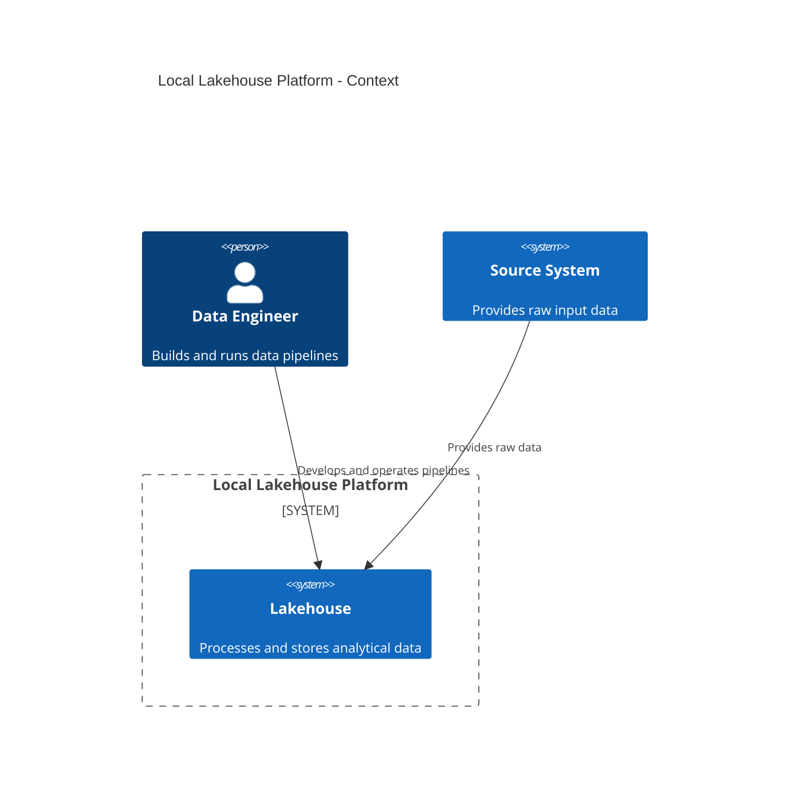

# 1 - Docs
## 1.1 - Planning and Architecture Diagrams (SKILL DOC)

For organization, planning, and architecture explanation, prefer the C4 Model using Mermaid.
Use C4 diagrams when the user asks for:

- System architecture
- Pipeline organization
- Component boundaries
- Service responsibilities
- Data platform planning
- Repository structure
- Local lakehouse design

Prefer this order when designing a platform:
```text
C4 Context -> C4 Container -> C4 Component
```
Use C4 Context to show external users, source systems, and the lakehouse platform.
Use C4 Component to show internal responsibilities inside a pipeline or application.

Example:



2 - Spark Performance Optimization (For Spark-History)

These techniques alter physical data movement and hardware utilization to speed up processing.
- **Data Partitioning & Bucketing:** Minimizes network traffic by pre-arranging data alignment.
- **Broadcast Joins:** Eliminates shuffles entirely for asymmetric datasets.
- **File Compaction:** Solves the "small files problem" to reduce storage driver strain.
- **Garbage Collection & Memory Tuning:** Optimizes executor heap space to prevent Out Of Memory (OOM) errors.

3 - Spark Development Best Practices & Coding Standards
These are the fundamental development rules applied directly during the coding phase.
- **Use High-Level APIs (DataFrames/SQL):** Avoid raw RDDs to ensure your code benefits from built-in optimization engines.
- **Explicit Data Pruning:** Always select specific columns and filter data as early as possible in your script.
- **Smart Caching Policy:** Explicitly cache data only when it is reused multiple times, and always call `unpersist()` afterward.