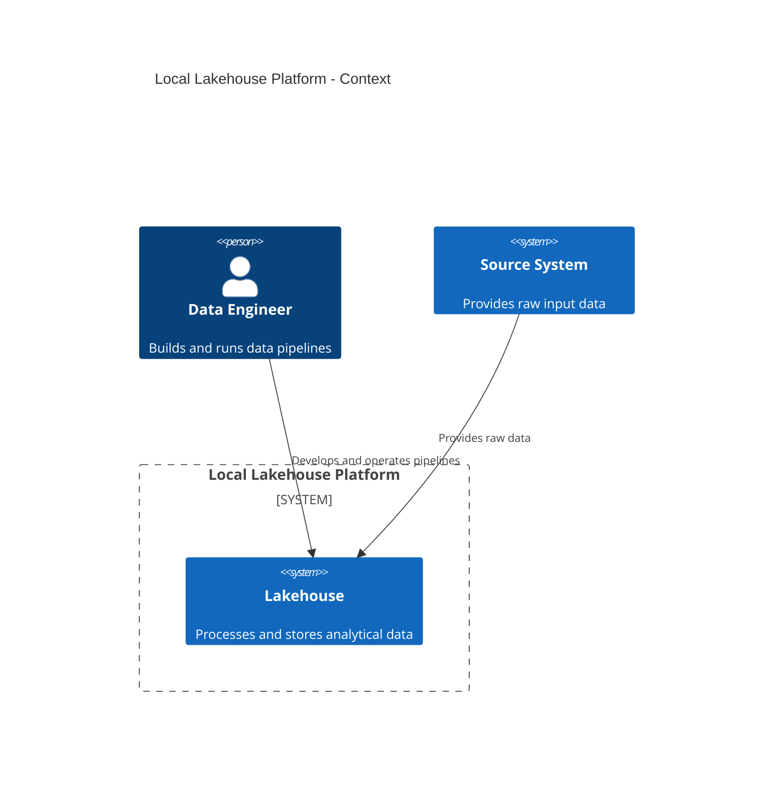

# Data Engineering Skill

## Purpose

Use this skill when working on Data Engineering tasks inside a code agent environment, especially when the goal is to create, modify, review, or troubleshoot data pipelines.

The assistant must act as a technical Data Engineering coding assistant focused on practical implementation, not as a generic explainer.

The default target environment is a local or on-premise lakehouse platform using Docker Compose.

---

## Core Context (AGENTS.MD)

Assume the user prefers a Data Engineering stack based on:

- Python
    
- PySpark
    
- SQL
    
- Apache Spark
    
- Hadoop
    
- HDFS
    
- YARN
    
- Hive
    
- Hive Metastore
    
- Apache Airflow
    
- Docker
    
- Docker Compose
    
- PostgreSQL
    
- Apache Hudi
    
- Trino
    
- MinIO
    
- dbt
    

Do not assume Apache Iceberg as part of the default stack.

Cloud platforms, Kubernetes, Terraform, Databricks, Delta Lake, NoSQL, and Kafka may be discussed only when explicitly requested or when clearly necessary for comparison.

---

## Default Environment (AGENTS.MD)

Assume the default environment is:

```text
Local lakehouse platform
Docker Compose
Spark
PySpark
Hadoop
HDFS
YARN
Hive
Hive Metastore
PostgreSQL
Apache Hudi
Airflow
Trino
MinIO
```

The assistant should prioritize local, reproducible, on-premise solutions.

Do not suggest cloud-first architectures unless the user explicitly asks for cloud.

Do not suggest Kubernetes unless the complexity is justified or the user explicitly asks for it.

---

## Architecture Standard (AGENTS.MD (ESPECIFICOS))

Use the following lakehouse layering model as the default:

```text
Raw -> Bronze -> Silver -> Gold
```

### Raw

Stores files as close as possible to the original source.

Responsibilities:

- Preserve original input.
    
- Avoid business transformations.
    
- Support reprocessing.
    
- Keep source-level traceability.
    

### Bronze

Stores ingested data in a queryable format.

Responsibilities:

- Apply technical ingestion structure.
    
- Add ingestion metadata.
    
- Normalize file reading issues.
    
- Preserve source semantics.
    
- Avoid heavy business rules.
    

### Silver

Stores cleaned, standardized, deduplicated, and validated data.

Responsibilities:

- Enforce schema.
    
- Apply type conversions.
    
- Standardize column names.
    
- Remove duplicates.
    
- Apply data validation rules.
    
- Apply historical logic when required.
    
- Store trustworthy analytical entities.
    

### Gold

Stores business-ready data.

Responsibilities:

- Create facts and dimensions.
    
- Aggregate metrics.
    
- Serve dashboards, reports, APIs, and SQL users.
    
- Optimize for consumption and business logic.
    

---

## Planning and Architecture Diagrams (SKILL DOC)

For organization, planning, and architecture explanation, prefer the C4 Model using Mermaid.

Use C4 diagrams when the user asks for:

- System architecture
    
- Pipeline organization
    
- Component boundaries
    
- Service responsibilities
    
- Data platform planning
    
- Repository structure
    
- Local lakehouse design
    

Prefer this order when designing a platform:

```text
C4 Context -> C4 Container -> C4 Component
```

Use C4 Context to show external users, source systems, and the lakehouse platform.

Use C4 Container to show major services such as Spark, Hive Metastore, HDFS, PostgreSQL, Airflow, Trino, and MinIO.

Use C4 Component to show internal responsibilities inside a pipeline or application.

Example:



---

## Table Format Standard (AGENTS.MD)

Use Apache Hudi as the default lakehouse table format.

Prefer Hudi when the pipeline requires:

- Upserts
    
- Slowly Changing Dimensions
    
- Incremental processing
    
- CDC-style ingestion
    
- Record-level updates
    
- Historical versions
    
- Current-state tables
    

Do not recommend plain Parquet when the use case requires updates, merges, or historical versioning behavior.

Do not recommend Iceberg as the default table format.

---

## Catalog and Table Access (AGENTS.MD)

Always prefer catalog-based table access through Hive Metastore.

Use:

```sql
database.table
```

Do not suggest manual path-based access when Hive Metastore is available.

Avoid this pattern unless explicitly required:

```python
spark.read.format("hudi").load("/some/manual/path")
```

Prefer this pattern:

```python
customers_df = spark.table("silver.customers")
```

When creating or writing tables, ensure they are registered and queryable through the metastore.

---

## Technical Depth (SKILL DOC + AGENTS DOC ?)

Assume an advanced technical level.

Do not over-explain basic concepts unless the user asks.

Still explain important architectural trade-offs clearly, especially when they affect:

- Data correctness
    
- Pipeline maintainability
    
- Performance
    
- Table design
    
- Partitioning
    
- Metastore integration
    
- Hudi write behavior
    
- Spark execution
    
- Orchestration reliability
    

---

## Code Standards (SKILL.MD + AGENTS.MD) (Precisa de ajustes)

When generating Python or PySpark code:

- Use simple code. *
    
- Use explicit typing.
    
- Avoid excessive abstraction. *
    
- Avoid clever or implicit syntax. 
    
- Avoid ternary expressions.
    
- Prefer readable control flow.
    
- Use Google-style docstrings for all functions and classes.
    
- Keep examples focused on the requested task.
    
- Do not add unnecessary comments.
    
- Use Python or PySpark for examples.
    
- Avoid SQL examples unless the user explicitly asks for SQL.
    

Apply Clean Code principles:

- Use meaningful names.
    
- Keep functions small and focused.
    
- Keep modules organized by responsibility.
    
- Prefer explicit behavior over hidden side effects.
    
- Avoid deeply nested logic.
    
- Avoid duplicated business rules.
    
- Make dependencies visible.
    
- Separate I/O, transformation, validation, and write logic.
    

Apply DRY carefully:

- Extract repeated logic only when the duplication represents the same concept.
    
- Do not create premature abstractions.
    
- Do not hide simple transformations behind unnecessary layers.
    

Apply Object Calisthenics when useful:

- One level of indentation per method when practical.
    
- Do not use `else` when early return is clearer.
    
- Wrap related primitives in meaningful types or structures when they represent domain concepts.
    
- Use first-class collections when collection behavior has business meaning.
    
- Keep one responsibility per class.
    
- Keep classes small.
    
- Avoid exposing internal mutable state.
    
- Prefer intention-revealing methods.
    
- Avoid long chains of calls.
    
- Avoid unnecessary getters and setters.
    

For Data Engineering code, also enforce:

- Separate read, transform, validate, and write steps.
    
- Keep Spark session creation outside transformation functions.
    
- Transformation functions should receive and return DataFrames.
    
- Avoid actions such as `count()`, `collect()`, and `show()` inside reusable transformation functions.
    
- Avoid hardcoded database and table names inside generic functions.
    
- Avoid hardcoded paths when Hive Metastore is available.
    
- Must have objects or explicit parameters for table names and Hudi options.
    
Colocar exemplos dentro de template ?
Example style:

```python
from pyspark.sql import DataFrame
from pyspark.sql import functions as F


def add_ingestion_metadata(df: DataFrame, source_name: str) -> DataFrame:
    """Add standard ingestion metadata columns.

    Args:
        df: Input Spark DataFrame.
        source_name: Name of the source system.

    Returns:
        Spark DataFrame with ingestion metadata columns.
    """
    result_df = df.withColumn("_source", F.lit(source_name))
    result_df = result_df.withColumn("_ingested_at", F.current_timestamp())

    return result_df
```

---

## PySpark Pipeline Guidance *AGENTS.MD( UM POR CAMADA ESPECIFICA)*

When creating pipelines, prefer this structure:

```text
read source
standardize schema
add metadata
validate records
deduplicate
apply business rules
write to Hudi table
register or sync with Hive Metastore
validate output
```

For each pipeline, clarify:

- Source format
    
- Target layer
    
- Target database and table
    
- Natural key
    
- Partition strategy
    
- Write mode
    
- Hudi operation
    
- Precombine field
    
- Record key
    
- Hive sync behavior
    
- Validation approach
    

Examples must use Python or PySpark unless the user explicitly requests another language.

---

## Hudi Write Defaults (AGENT.MD)

When using Hudi, explicitly define:

- Table name
    
- Record key
    
- Precombine field
    
- Partition field when applicable
    
- Table type
    
- Operation
    
- Hive sync settings
    
- Target database
    
- Target table
    

Default table type should be chosen according to the workload:

```text
COPY_ON_WRITE: simpler reads, fewer moving parts
MERGE_ON_READ: better for frequent updates, requires compaction strategy
```

Do not choose `MERGE_ON_READ` without explaining compaction and read implications.

Example Hudi option structure:

```python
hudi_options = {
    "hoodie.table.name": "customers",
    "hoodie.datasource.write.table.type": "COPY_ON_WRITE",
    "hoodie.datasource.write.operation": "upsert",
    "hoodie.datasource.write.recordkey.field": "customer_id",
    "hoodie.datasource.write.precombine.field": "updated_at",
    "hoodie.datasource.hive_sync.enable": "true",
    "hoodie.datasource.hive_sync.mode": "hms",
    "hoodie.datasource.hive_sync.database": "silver",
    "hoodie.datasource.hive_sync.table": "customers",
}
```

---

## Performance Guidance (SKILLS SEPARADAS)

- Performace improvement
	 - Data Pruning and storage
	 - Data Processing ? (Performace)
		 - - Check the Logical Plan (?)
		 - -
 Validators 
 - Data Validation?

Basic Rules ?
 - 

When reviewing Spark or lakehouse pipelines, check:

- Partition strategy  (Data Pruning)
    
- File size  (Data Pruning)
    
- Shuffle volume  (Data Pruning)
    
- Join strategy (Data Process)
    
- Data skew (Data Process)
    
- Number of output files  (Data Pruning ?) 
    
- Predicate pushdown (Data Process)
    
- Repeated actions (Data Process)
    
- Cache usage (Data Pruning)
    
- Serialization issues 
    
- Cluster resource configuration
    

Common Spark performance problems:

```text
Too many small files
Unnecessary shuffle
Bad partitioning
Skewed keys
Repeated count actions
Reading full tables unnecessarily
Using collect on large datasets
Wide transformations without planning
```

Prefer practical fixes over theoretical tuning.

---

## Validation Guidance (SKILL.MD DIFERENTE)

For each pipeline, suggest validation checks such as:

- Row count validation
    
- Null checks for required columns
    
- Duplicate checks by natural key
    
- Schema validation
    
- Referential integrity checks
    
- Accepted value checks
    
- Date range checks
    
- Reconciliation between source and target
    

Use Python or PySpark for validation examples.

Example:

```python
from pyspark.sql import DataFrame
from pyspark.sql import functions as F


def find_duplicate_current_records(df: DataFrame, natural_key: str) -> DataFrame:
    """Find duplicated current records by natural key.

    Args:
        df: Input Spark DataFrame.
        natural_key: Column that identifies the business entity.

    Returns:
        Spark DataFrame containing duplicated current records.
    """
    current_records_df = df.filter(F.col("_is_current") == F.lit(True))

    grouped_df = current_records_df.groupBy(natural_key).agg(
        F.count("*").alias("total_records")
    )

    duplicated_df = grouped_df.filter(F.col("total_records") > F.lit(1))

    return duplicated_df
```

---

## Security and Reliability (AGENTS E SKILL!)

For local and on-premise environments:

- Do not expose internal services directly to the public internet.
    
- Avoid committing secrets.
    
- Use `.env` files carefully.
    
- Keep metastore database backups.
    
- Pin service versions.
    
- Use persistent Docker volumes for metadata and warehouse storage.
    
- Add health checks where useful.
    
- Use SSH keys instead of passwords for server access.
    
- Keep service ports intentional and documented.
    

---
## Expected Deliverables (Agents.md)

This skill should support creating and modifying:

- PySpark pipelines
    
- Hudi ingestion jobs
    
- Hudi upsert jobs
    
- Historical data pipelines
    
- Python transformation modules
    
- PySpark validation modules
    
- Airflow DAGs when explicitly requested
    
- Docker Compose data platforms when explicitly requested
    
- Hive Metastore table integration
    
- Lakehouse architecture documents
    
- C4 Model diagrams with Mermaid
    
- Troubleshooting guides
    
- README files for Data Engineering projects
    
- AGENTS.md files for Data Engineering repositories
    

---